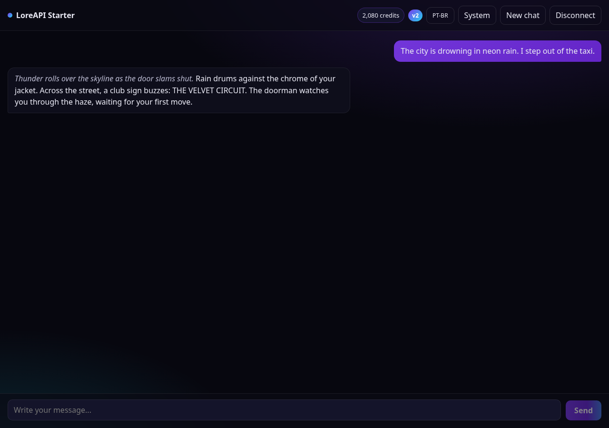

# lore-starter

A tiny open-source chat UI for [LoreAPI](https://loreapi.online), the OpenAI-compatible AI API for roleplay and creative apps: 1M token context, ~100 tok/s, unfiltered, from $2 per 200 credits.

Paste your own `sk-lore-...` key in the UI and start chatting. The key stays in your browser (localStorage) and is only sent to `loreapi.online`.

## Screenshot



## Features

- English and Brazilian Portuguese UI with a one-click switch (auto-detects your browser language)
- Streaming responses (SSE)
- Bring your own key: connect, see your credits and model, disconnect anytime
- Editable system prompt
- Conversation history kept in localStorage
- Friendly errors for invalid key, no credits and weekly limit
- No backend and no database: Next.js App Router + TypeScript + plain CSS

## Quickstart

```bash
npm install
npm run dev
```

Open [http://localhost:3000](http://localhost:3000) and paste your key. No key yet? Get one at [loreapi.online](https://loreapi.online).

## One-click deploy

[](https://vercel.com/new/clone?repository-url=https%3A%2F%2Fgithub.com%2FDuduSync%2Flore-starter)

## How it works

- `lib/loreapi.ts` is the entire API client: `fetchAccount`, `fetchModel` and `streamChat` (SSE parsing included).
- `app/ChatApp.tsx` is the whole UI: a setup screen that validates your key and a chat screen with streaming.
- Calls go straight from the browser to `https://loreapi.online/v1` (CORS is open), so there is nothing to host besides the static app.
- Point it somewhere else with the `NEXT_PUBLIC_LOREAPI_BASE` environment variable if you ever need to.

## Project structure

```
app/
  ChatApp.tsx    the whole UI (setup + chat)
  layout.tsx     metadata and fonts-agnostic shell
  page.tsx       renders ChatApp
  globals.css    dark theme with LoreAPI colors
lib/
  loreapi.ts     API client (account, models, streaming chat)
```

## License

[MIT](LICENSE)
